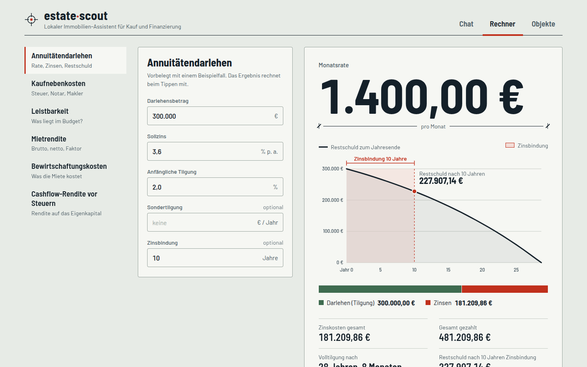

# estate-scout

[](https://github.com/sutheimernico/estate-scout/actions/workflows/ci.yml)

**A local real-estate assistant for the German market whose numbers never come from the language
model: it picks the calculator, tested Python does the maths, and a code-level guard flags any
figure in the answer that no calculator produced.**

<!-- hero: docs/media/hero.png is added together with the UI redesign -->
<!--  -->

Runs entirely on your machine via [Ollama](https://ollama.com) — no paid APIs, no listing scraping.
Not tax, investment or financing advice.

**One result, end to end.** "300.000 € at 3,6 % Sollzins, 2 % Tilgung, 10 years fixed" →
**1.400,00 € per month**, **95.907 € interest** and a **Restschuld of 227.907 €** when the
Zinsbindung ends (full repayment after 28,7 years). The assistant calls the `annuity` tool, the
UI renders the exact result as a card, and if the model's prose quotes a figure that is not in the
result (a live run once turned 181,209.86 into "181.210,86") the answer is flagged.

```bash
uv sync
cd frontend && npm install && npm run build && cd ..
uv run uvicorn estatescout.api:app --port 8000     # -> http://localhost:8000
# chat needs Ollama: ollama pull qwen2.5:7b && ollama pull nomic-embed-text
# the calculators and the object list work without it
```

## How this was built

Spec-driven agentic development. I (Nico Sutheimer) wrote the specs and plans — they are in
[`docs/superpowers/`](docs/superpowers) — and AI coding agents implemented them task by task. I
reviewed every change and own the verification: the test suites are the gate, not the agent's
say-so. The gate that every commit has to pass:

| Check | Command |
| --- | --- |
| Backend tests (hermetic, ≥ 95 % coverage floor) | `uv run pytest` |
| Lint, format, types | `uv run ruff check . && uv run ruff format --check . && uv run mypy` |
| Frontend types and tests | `cd frontend && npx tsc --noEmit && npm test` |

The same commands run in [GitHub Actions](.github/workflows/ci.yml). The design decisions that
matter (why no scraping, why the Bodenrichtwert comes from a public WFS, why the score is a
transparent heuristic) are written down in [`docs/adr/`](docs/adr) and
[`docs/bodenrichtwert-quelle.md`](docs/bodenrichtwert-quelle.md).

## Why the numbers are trustworthy

A local 7B model cannot be trusted with arithmetic. So it doesn't do any: every number
(Annuitätendarlehen rate and Restschuld after the Zinsbindung, Kaufnebenkosten, Leistbarkeit,
Mietrendite, Bewirtschaftungskosten, Cashflow-Rendite) is computed by tested Python in `finance/`. The assistant understands your
question, calls the right calculator, and explains the result. Tax rates and thresholds live in
versioned config, each tagged with source + date. Every calculator has a typed request/response
model (`schemas.py`): FastAPI shows them in `/docs`, and the LLM tool schemas are derived from the
same models.

Two definitions worth stating plainly: the **Cashflow-Rendite vor Steuern** subtracts the full debt
service (interest and Tilgung) from the net rent and divides by the equity, and reports the
year-1 Tilgung separately as wealth built — taxes and AfA are not modelled. And the Bundesbank
figure below is an *Effektivzins*, so the API returns it together with an estimated *Sollzins*
(`(1 + eff)^(1/12)` conversion), which is what the loan calculators take.

## The score

Saved objects get a transparent **0–100 assessment** built from three visible blocks:

| Block          | What it measures                                            | Weight |
| -------------- | ----------------------------------------------------------- | ------ |
| Rendite        | gross rental yield (0 % → 0, ≥ 6 % → 100)                     | 0.4    |
| Preisniveau    | €/m² living space ÷ local Bodenrichtwert (≤ 3 → 100, ≥ 20 → 0) | 0.4    |
| Lage           | population trend and vacancy rate                             | 0.2    |

Weights and thresholds live in `config/scoring.yaml` with `source` + `as_of` — they are own
heuristics, in config precisely so they can be argued with. The total is the weighted mean of the
blocks that could actually be computed, with the weights renormalized over those; **if no block is
computable the total is `null`, never a fabricated 0.** A confidence figure reports how many of the
four raw signals were available, and every gap names its reason (`provider_missing` = no data
source configured, `no_data` = the source knows nothing about this object, `rent_missing` = you did
not supply a Kaltmiete).

The Bodenrichtwert is the **median residential land value of the Gemeinde** from the public BORIS
Niedersachsen WFS (keyless, Datenlizenz Deutschland Namensnennung 2.0, © GDI-NI) — a transparent
proxy for "expensive for the area", not a valuation. See `docs/bodenrichtwert-quelle.md`.

```bash
uv run python scripts/scout.py enrich 1          # pull the public reference data
uv run python scripts/scout.py score 1 --rent 1000
```

## Live data

`GET /api/market-rate` and the assistant's `market_rate` tool report the current average **effective**
interest rate (`effective_rate_percent`, plus the estimated `nominal_rate_percent`) for new German housing loans, straight from the Deutsche Bundesbank SDMX API
(`BBIM1/M.DE.B.A2C.A.R.A.2250.EUR.N`, keyless, cached 24 h). If the call fails, the static value
from `config/rates.yaml` is returned **and labelled as a fallback** — a stale number is never
passed off as today's. The calculators themselves stay pure and offline; the live rate is a
suggestion, never a silent default.

## Verifying the LLM integration

The test suite is hermetic on purpose (every Ollama call is faked), so it cannot prove the real
integration works. This does:

```bash
./scripts/verify_live.sh     # real Ollama: embedder, RAG, tool call, scoring
```

It prints PASS/FAIL per check, exits non-zero on a real failure, and exits 0 with a clear message
when Ollama simply is not running. Opt-in pytest checks against real public APIs (BORIS-NI,
Bundesbank):

```bash
uv run pytest -m live
```

## Status

Stage 1 (knowledge + finance assistant) and the Stage-2 scoring funnel are built: manual intake →
enrichment → transparent score → drilldown, in CLI, API and UI. See `docs/superpowers/plans/` for the executed plans. Later stages (per-object exposé evaluation,
copilot, dashboard) are sketched but not built.

## Quickstart (after `uv sync`)

```bash
# Deterministic calculators (no LLM needed)
uv run python scripts/finance.py annuity --principal 280000 --rate 3.6 --repayment 2.0 \
  --zinsbindung 10                                                       # + Restschuld after 10 years
uv run python scripts/finance.py costs --price 350000 --bundesland Niedersachsen
uv run python scripts/finance.py yield --price 350000 --rent 1200
uv run python scripts/finance.py opcosts --area 100 --rent 1200          # Bewirtschaftungskosten
uv run python scripts/finance.py equity --price 300000 --rent 1500 \
  --equity 60000 --rate 3.6 --repayment 2.0                              # Cashflow-Rendite vor Steuern

# Saved objects (manual intake — no scraping)
uv run python scripts/scout.py add --price 300000 --area 100 --bundesland NI --ort Lingen
uv run python scripts/scout.py list
uv run python scripts/scout.py seed-example      # one object with full data coverage (illustrative values)
uv run python scripts/scout.py delete 1

# Ask the assistant (needs Ollama running + a tool-calling model + an embedding model)
ollama serve & ollama pull qwen2.5:7b && ollama pull nomic-embed-text
uv run python scripts/ask.py "Welche Nebenkosten fallen beim Kauf in Niedersachsen an?"
uv run python scripts/ask.py "Welche Objekte habe ich gespeichert?"   # uses the list_listings tool
```

The assistant model is configurable via `OLLAMA_MODEL` (default a local tool-calling model), the
embedding model via `OLLAMA_EMBED_MODEL`. The knowledge index is embedded once and cached on disk
(`data/rag_index/`, regenerable); it is rebuilt automatically when the corpus changes.

## Web UI

```bash
cd frontend && npm install && npm run build && cd ..
uv run uvicorn estatescout.api:app --port 8000   # → http://localhost:8000
```

Three tabs:

- **Chat** — ask anything; every calculator the assistant calls is rendered as its own result card,
  with the knowledge sources it cited.
- **Rechner** — the six calculators as direct forms, no LLM involved (works with Ollama down),
  pre-filled with visible example values.
- **Objekte** — your saved objects: intake form, table with €/m² and score badge, a per-object
  drilldown (bar per block, the weight it actually carried, confidence, and an honest list of what
  was missing and why), and an "Anreichern + bewerten" action.

Each assistant answer carries a collapsed **"Werkzeuge (n)"** panel listing every calculator it
called with the exact arguments and the exact result — the honest-harness claim, inspectable.

A code-level guard (`assistant/number_check.py`) compares every number in the answer text with the
tool results and the user's own figures; anything untraceable is shown as a warning above the
answer (and in the CLI output). It reports, it never rewrites. It exists because a live run
garbled a tool figure in prose (181,209.86 became "181.210,86").

## Nightly re-score digest

```bash
uv run python scripts/nightly_rescore.py   # writes data/digests/<date>.md (German Markdown)
```

Re-enriches and re-scores all saved objects and lists what changed since the last run (score
before → after, and which input moved). Previous scores are kept in `data/score_state.json`; both
paths are gitignored. Ready-made systemd user units live in `deploy/` — they are **not**
installed or enabled by anything in this repo; copy them to `~/.config/systemd/user/`, adjust
`WorkingDirectory`, then `systemctl --user enable --now estate-scout-rescore.timer`.

## Development

```bash
uv sync
uv run pytest                  # tests + coverage floor (single-file runs: add --no-cov)
uv run ruff check . && uv run ruff format --check .
uv run mypy
cd frontend && npm install && npx tsc --noEmit && npm test && npm run build
```

`uv run pytest` enforces a measured coverage floor (`fail_under` in `pyproject.toml`) and excludes
the `live` marker, so the default run never touches the network.

## License

MIT — see `LICENSE`.
